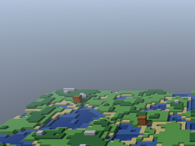
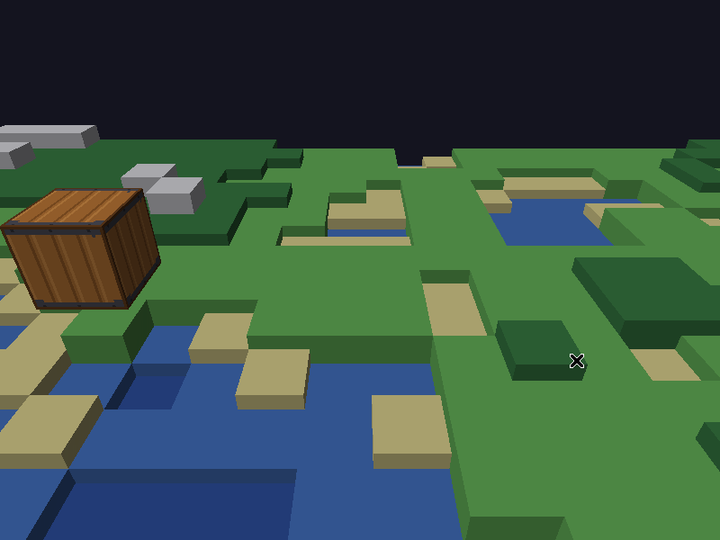

# MyEngine

My own game engine, built from scratch in C++20, one lesson at a time — and documented as it goes. It is a portfolio piece: an engine library, a dockable editor, a standalone runtime with two real games on it, and a raw-OpenGL 3D host, all from one CMake project. Procedural generation is a foundation, not an add-on: the world is a deterministic function of a seed from the very first systems up — same seed, same world, provably (the full tile grid checksums identically across refactors; see Lesson 38's devlog).

**Stack:** C++20, CMake, SFML 3.0.2 (windowing, input, audio), Dear ImGui (docking build) + ImGui-SFML for the editor UI, Lua 5.4.7 (hand-bound, no binding library) for per-game scripting, and raw OpenGL 3.3 with a hand-written function loader for the 3D — no GLAD, no engine framework anywhere.

**Status: Phase 2 complete through Arc 9; Arc 10 (Ship 2.0) underway.** **MyEngine 1.8.0** (tagged `v1.8.0`) is the current release; 2.0.0 is in preparation. Phase 1 (nine arcs, Lessons 1–43) shipped as 1.0.0; Phase 2 (ten arcs, Lessons 44–97) added game feel, platformer physics, projects as folders, Lua scripting, a second game, campaigns and saves, a grown-up editor, and the 3D second season. The plans live in [docs/ROADMAP.md](docs/ROADMAP.md), [docs/ROADMAP_PHASE2.md](docs/ROADMAP_PHASE2.md), and [docs/ROADMAP_PHASE3.md](docs/ROADMAP_PHASE3.md); the release story in [CHANGELOG.md](CHANGELOG.md).






## What exists today

Four targets, one CMake project — plus the harness that keeps them honest:

- **GameLib** — the engine: deterministic procgen (master seed + named RNG streams, value noise with fBm, an 80×60 tile world with per-type movement speeds), data-driven entities with sprite animation and AABB collision (per-entity hitboxes) under two movement models — top-down steering and platformer gravity with grounded state, coyote time, jump buffering, variable jump height, a solidity table making the tile grid itself platformer collision, one-way platforms, and moving platforms that carry their rider —, easing curves and tweens, a CPU particle pool with data-driven emitters, a camera with smooth lookahead follow, trauma-based shake and hit-stop, collection streaks, shockwave rings and a staged win sequence. On top of that core: **entity types and Lua scripting** (behaviour lives in the game's own script files, with hot reload), **multi-scene campaigns** with doors that travel between scenes, a **UI widget kit**, **versioned saves**, scene save/load, resource caches with placeholder fallbacks, logging, per-machine config, the project-folder format, and a fully synthesized soundscape — footsteps, splashes, bumps, clicks, pickups, a win jingle, and a music loop, all generated in code. No recorded audio, no licensed assets.
- **MyEngine** — the editor: dockable ImGui panels (Engine Debug, Procgen, Console, Game View, Hierarchy, Inspector, Project, Levels, Terrain, Feel, Physics), a resizable game view rendered to a texture plus a **pop-out Game View** and a second view for a second scene, play/pause/step, live seed/noise controls, entity picking, drag-to-move, spawn/delete, snapshot undo/redo, terrain painting stored as differences over the generated world, and play-in-editor that restores the scene *exactly* when you stop. Since Lesson 93 it also has a **3D View**: the scene being edited, rendered as a lit heightfield by the same TerrainMesh/GLProgram code the 3D host flies.
- **MyRuntime** — the standalone player. It ships two games: **Gold Rush** (collect all 40 gold dots in a seeded world — title, pause, and win screens, a run timer, terrain that helps or hinders you) and **Temple Run** (an endless upward climb through stacked chunks, scripted entirely in Lua — height is the score). Both are packaged as self-contained zips by `tools/package_game.sh` (Linux) or the PowerShell mirror in [docs/WINDOWS_BUILD.md](docs/WINDOWS_BUILD.md).
- **MyGL** — the raw-OpenGL host: the same tile world extruded into a 3D heightfield with Blinn-Phong specular materials, **shadow mapping** from a 2048-deep sun pass, OBJ-loaded meshes (the game's crates stand in the 3D world at their 2D positions, placed from the entity list), a gradient sky dome, and distance fog that shares one horizon colour with the sky. One world, two renderers, one shared palette — flown over with a free camera.
- **MyTests** — the headless harness (Lesson 45): 69 checks of the engine's contracts — world determinism (with a hard checksum of the 1.0 world), scene and campaign round-trips, project/config parsing, the script host, the OBJ loader, the shadow-camera capstone, and render checks measured in pixels. One command, an exit code CI can read. Since Lesson 46, GitHub Actions builds the whole engine on Linux and Windows for every push to `main` and runs this harness on both.

## Build

Dependencies (SFML, ImGui, ImGui-SFML, Lua) are fetched and built by CMake itself.

**Linux:**

```
cmake -B BuildLinux -DCMAKE_BUILD_TYPE=Release
cmake --build BuildLinux
```

**Windows:** see [docs/WINDOWS_BUILD.md](docs/WINDOWS_BUILD.md) — the full walkthrough, including packaging.

Run every host **from the repo root** (asset paths like `assets/crate.tga` resolve relative to the working directory). The runtime takes a project folder as its argument: `MyRuntime games/temple-run` plays Temple Run.

## Controls

- **Runtime (Gold Rush):** Enter starts, WASD/arrows move, P or Esc pauses, R on the win screen deals a fresh world, Esc quits. F5/F9 quicksave/quickload the scene.
- **Editor:** Play/Pause/Step drive game time; click entities in the Game View or Hierarchy to select; drag to move; the Procgen panel applies seeds; mouse wheel zooms, right-drag pans; F5/F9 save/load.
- **MyGL:** WASD flies along the look direction, Q/E sink/rise, arrow keys look, Esc quits.

## Files and formats

- **A project is a folder** (Lesson 60): `project.myengine` inside it — the game's identity card (`format`, `name`, `seed`, start scene) — flanked by `assets/`, `scenes/`, and `scripts/`. Hosts read the card first; every in-project path resolves against the folder through one shared rule.
- `scenes/*.txt` — saved scenes (format v2): seed plus entity list, with types and script stamps. Terrain is *not* stored — it regenerates from the seed, exactly, every time; hand-painted tiles are stored as differences.
- `scripts/*.lua` — per-game behaviour: entity logic, hooks, and whole NPCs, hot-reloadable from the editor.
- `save.dat` — the versioned save file: it carries its format version and refuses a newer one politely rather than misreading it.
- `engine.ini` — per-machine settings (created with defaults if missing): window size, seed, noise scale, player speed, volume, music. The project file wins on the things it defines.

## What 1.8 is not

Honesty is part of the portfolio. There is no networking. The editor's 3D View is a view, not a 3D editor — 3D authoring happens in the 2D scene and the OBJ files. The audio is synthesized, and its playback timing is verified by ear on a real machine, not on the headless build rig. And the front door is still engine-shaped: windows open in the arrangement of a tracked `imgui.ini` rather than a designed default layout, a project is opened by pointing the editor at its folder rather than from a start screen, and files are added to a project from the filesystem rather than from the Project panel. Those three are not oversights — they are Phase 3, planned in [docs/ROADMAP_PHASE3.md](docs/ROADMAP_PHASE3.md), because the author hit them in that order within an hour of his first hands-on build. Godot is 25 years and hundreds of contributors; this is one developer and 97 lessons — scoped to what a solo dev needs to ship 2D games, and understood all the way down.

## License

MIT — see [LICENSE](LICENSE). Copyright (c) 2026 Zachary Shade. Use it, learn from it, ship something with it.

The bundled DejaVu font keeps its own license (`assets/DejaVu-LICENSE.txt`), and the vendored Khronos headers (`vendor/GL/glext.h`, `vendor/KHR/khrplatform.h`) are MIT-licensed by the Khronos Group.

## Documentation

- [docs/ROADMAP.md](docs/ROADMAP.md) — the Phase 1 plan (nine arcs, 43 lessons as built)
- [docs/ROADMAP_PHASE2.md](docs/ROADMAP_PHASE2.md) — the Phase 2 plan (ten arcs, Lessons 44–98)
- [docs/ROADMAP_PHASE3.md](docs/ROADMAP_PHASE3.md) — the Phase 3 sketch: the engine feels standard
- [docs/LESSON_BLOG.md](docs/LESSON_BLOG.md) — the narrative blog of every lesson
- [docs/devlog/](docs/devlog/) — one devlog per lesson: goal, concept, code built, what broke, verification
- [docs/shots/](docs/shots/) — the screenshot record, one or more per lesson
- [docs/WINDOWS_BUILD.md](docs/WINDOWS_BUILD.md) — building and packaging on Windows
