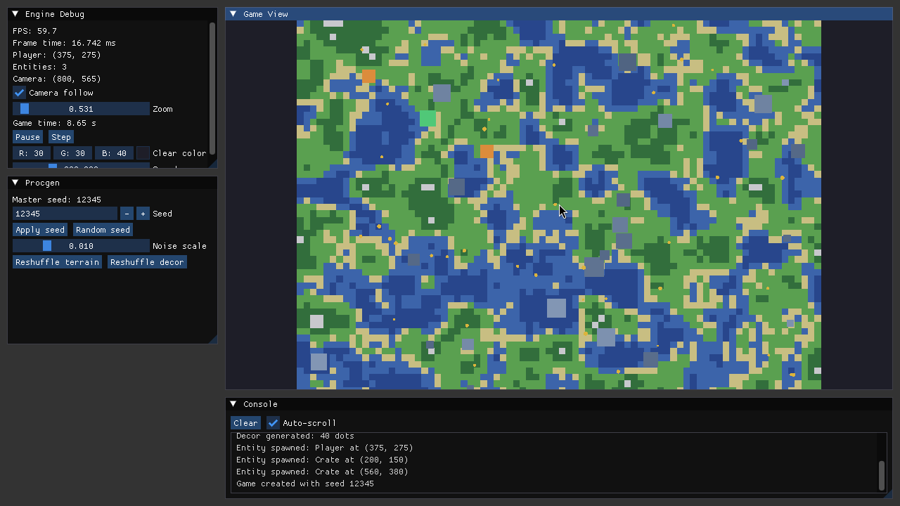

# MyEngine

My own game engine, built from scratch in C++20, one lesson at a time — and documented as it goes. It shipped as a portfolio piece: an engine library, a dockable editor, a standalone runtime with a real game on it, and a raw-OpenGL 3D host, all from one CMake project. Procedural generation is a foundation, not an add-on: the world is a deterministic function of a seed from the very first systems up — same seed, same world, provably (the full tile grid checksums identically before and after the Arc 8 refactor; see Lesson 38's devlog).

**Stack:** C++20, CMake, SFML 3.0.2 (windowing, input, audio), Dear ImGui (docking build) + ImGui-SFML for the editor UI, and raw OpenGL 3.3 with a hand-written function loader for the 3D host — no GLAD, no engine framework anywhere.

**Status: Phase 2 underway — Lesson 46 complete** (Arc 1: First Contact — the playtest-hardening arc). **MyEngine 1.0.0** (tagged `v1.0.0`) is the Phase 1 release: Arc 1 ✅ · Arc 2 ✅ · Arc 3 ✅ · Arc 4 ✅ · Arc 5 ✅ · Arc 6 ✅ · Arc 7 ✅ · Arc 8 ✅ · Arc 9 ✅. The Phase 1 plan lives in [docs/ROADMAP.md](docs/ROADMAP.md), Phase 2's in [docs/ROADMAP_PHASE2.md](docs/ROADMAP_PHASE2.md); the release story in [CHANGELOG.md](CHANGELOG.md).




## What exists today

Four targets, one CMake project — plus the harness that keeps them honest:

- **GameLib** — the engine: deterministic procgen (master seed + named RNG streams, value noise with fBm, an 80×60 tile world with per-type movement speeds), data-driven entities with sprite animation and AABB collision (with per-entity hitboxes), a camera, scene save/load, resource caches with placeholder fallbacks, a logging system, per-machine config, a project file format, and a fully synthesized soundscape — footsteps, splashes, bumps, clicks, pickups, a win jingle, and a music loop, all generated in code. No recorded audio, no licensed assets.
- **MyEngine** — the editor: dockable ImGui panels (Engine Debug, Procgen, Console, Game View, Hierarchy, Inspector), a resizable game view rendered to a texture, play/pause/step, live seed/noise controls, entity picking, drag-to-move, spawn/delete, snapshot undo/redo, and play-in-editor that restores the scene *exactly* when you stop.
- **MyRuntime** — the standalone player. It ships **Gold Rush**: collect all 40 gold dots in a seeded world — title, pause, and win screens, a run timer, terrain that helps or hinders you. Packaged as a self-contained zip by `tools/package_game.sh` (Linux) or the PowerShell mirror in [docs/WINDOWS_BUILD.md](docs/WINDOWS_BUILD.md).
- **MyGL** — the raw-OpenGL host: the same tile world extruded into a sun-lit 3D heightfield (Lambert lighting, textured meshes), flown over with a free camera. The game's crates stand in the 3D world at their 2D positions, placed from the entity list — one world, two renderers, one shared palette.
- **MyTests** — the headless harness (Lesson 45): ten checks of the engine's contracts — world determinism (with a hard checksum of the 1.0 world), scene round-trips, project/config parsing, and the Lesson 44 flip regression, rendered and measured. One command, an exit code CI can read; run it under `xvfb-run` on display-less machines. Since Lesson 46, GitHub Actions builds the whole engine on Linux and Windows for every push to `main` and runs this harness on both.

## Build

Dependencies (SFML, ImGui, ImGui-SFML) are fetched and built by CMake itself.

**Linux:**

```
cmake -B BuildLinux -DCMAKE_BUILD_TYPE=Release
cmake --build BuildLinux
```

**Windows:** see [docs/WINDOWS_BUILD.md](docs/WINDOWS_BUILD.md) — the full walkthrough, including packaging.

Run every host **from the repo root** (asset paths like `assets/crate.tga` resolve relative to the working directory).

## Controls

- **Runtime (Gold Rush):** Enter starts, WASD/arrows move, P or Esc pauses, R on the win screen deals a fresh world, Esc quits. F5/F9 quicksave/quickload the scene.
- **Editor:** Play/Pause/Step drive game time; click entities in the Game View or Hierarchy to select; drag to move; the Procgen panel applies seeds; mouse wheel zooms, right-drag pans; F5/F9 save/load.
- **MyGL:** WASD flies, Q/E sink/rise, arrow keys look, Esc quits.

## Files and formats

- `project.myengine` — the game's identity card (Lesson 41): `format`, `name`, `seed`, `scene`. It travels with the game and defines it; hosts read it first.
- `engine.ini` — per-machine settings (created with defaults if missing): window size, seed, noise scale, player speed, volume, music. The project file wins on the things it defines.
- `scene.txt` — a saved scene: seed plus entity list. Terrain is *not* stored — it regenerates from the seed, exactly, every time.

## What 1.0 is not

Honesty is part of the portfolio: there is no scripting language, no physics beyond AABB collision, no networking, no 3D view inside the editor (MyGL is a separate host), and no asset pipeline beyond code-generated or hand-made files. The audio is synthesized and its playback timing is verified by ear on a real machine, not on the headless build rig. Godot is 25 years and hundreds of contributors; this is one developer and 43 lessons — scoped to what a solo dev needs to ship 2D games, and understood all the way down.

## Documentation

- [docs/ROADMAP.md](docs/ROADMAP.md) — the nine-arc plan (43 lessons as built; the devlog numbering is authoritative)
- [docs/LESSON_BLOG.md](docs/LESSON_BLOG.md) — the narrative blog of every lesson
- [docs/devlog/](docs/devlog/) — one devlog per lesson: goal, concept, code built, what broke, verification
- [docs/shots/](docs/shots/) — the screenshot record, one or more per lesson
- [docs/WINDOWS_BUILD.md](docs/WINDOWS_BUILD.md) — building and packaging on Windows
- [CHANGELOG.md](CHANGELOG.md) — release notes

_Upkeep rule (kept for all 43 lessons): every lesson updates the devlog, the lesson blog, and this README in the same commit as the code._
